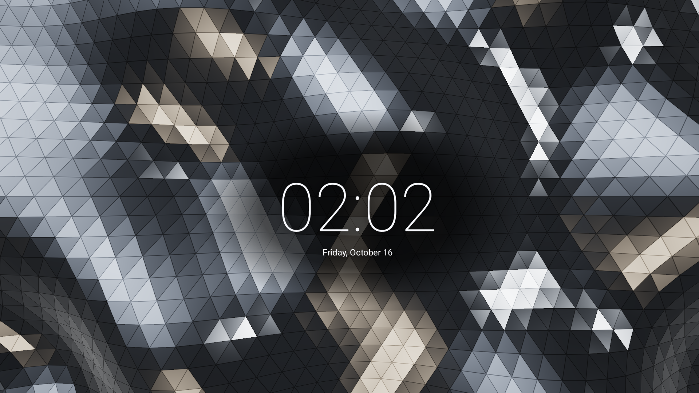
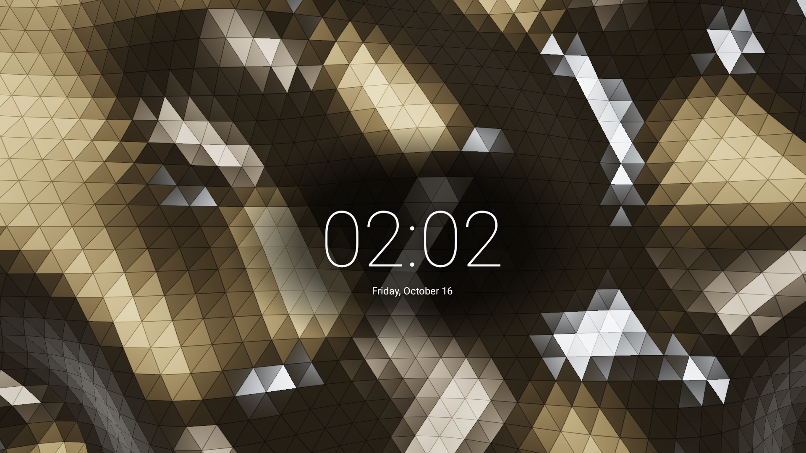
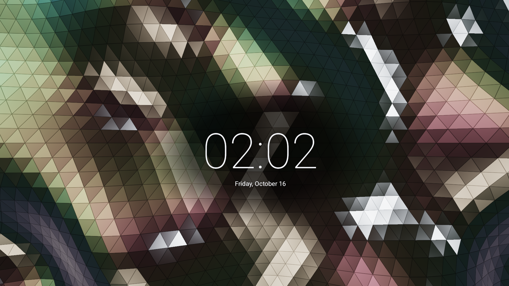
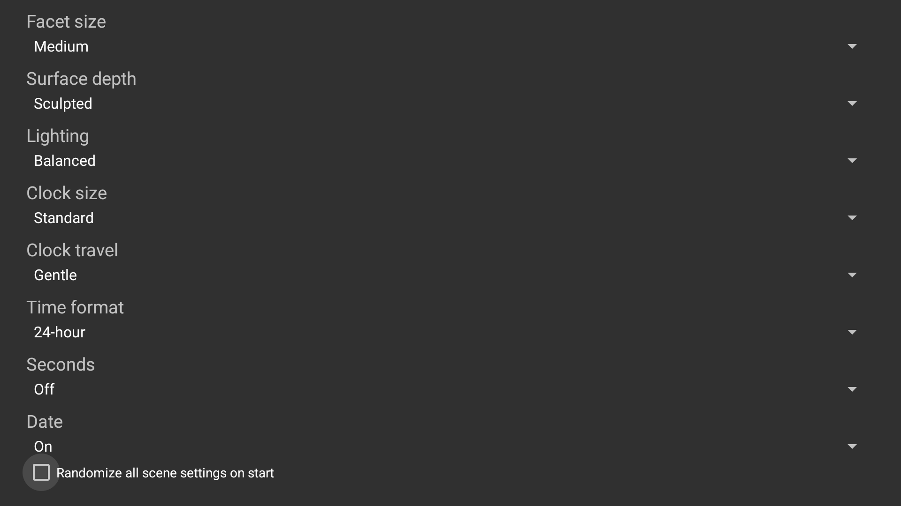

<p align="center">
  <a href="https://github.com/jeremykenedy/prism-clock#gh-light-mode-only"><picture><source media="(max-width: 600px) and (prefers-reduced-motion: reduce)" srcset="art/banner-mobile-still-light.f3c2c92812dc.svg"><source media="(prefers-reduced-motion: reduce)" srcset="art/banner-still-light.8d7269506a81.svg"><source media="(max-width: 600px)" srcset="art/banner-mobile-light.46f30ec35a1d.svg"></picture></a>
  <a href="https://github.com/jeremykenedy/prism-clock#gh-dark-mode-only"><picture><source media="(max-width: 600px) and (prefers-reduced-motion: reduce)" srcset="art/banner-mobile-still-dark.f707cdce7e17.svg"><source media="(prefers-reduced-motion: reduce)" srcset="art/banner-still-dark.d2d168ce9fc5.svg"><source media="(max-width: 600px)" srcset="art/banner-mobile-dark.be2bc8b36a84.svg"></picture></a>
</p>

<p align="center">A native clock over a continuously deforming metallic triangular surface.</p>

<p align="center"><a href="https://github.com/jeremykenedy/prism-clock/actions/workflows/ci.yml"></a> <a href="LICENSE"></a></p>

<p align="center"><a href="https://github.com/jeremykenedy"></a> <a href="https://github.com/jeremykenedy/prism-clock"></a> <a href="https://github.com/sponsors/jeremykenedy"></a></p>

Show some love by [starring this repository on GitHub](https://github.com/jeremykenedy/prism-clock).

Prism Clock is currently an unreleased development candidate. The current scene has passed its initial native rendering and Dream checks; full settings, playback, physical-device and release gates remain pending. There is no release to download and it has not been registered in Fire TV Toolkit or Fire TV UI yet.

## Table of Contents

- [Requirements](#requirements)
- [Installation](#installation)
- [Features](#features)
- [Configuration](#configuration)
- [Fire TV Toolkit](#fire-tv-toolkit)
- [Device Verification](#device-verification)
- [Testing](#testing)
- [Documentation](#documentation)
- [Screenshots](#screenshots)
- [Privacy](#privacy)
- [License](#license)

## Requirements

The APK targets Android API 36 with a minimum API of 23 and requires OpenGL ES 2.0. These declared requirements do not establish compatibility with every device. See the verification matrix below.

Source builds need Java, Python 3.10 or newer, Android SDK platform 36 and build-tools 36.0.0. Style checks also need ShellCheck. The app has no runtime dependencies.

## Installation

No public release is available yet. For a locally verified build:

```sh
bash build.sh
python3 install.py --serial YOUR_ADB_SERIAL --apk build/prism-clock.apk
```

The installer asks before changing the selected device. Updates use Android's same-package, same-signer replacement and preserve app settings. It does not change the TV's selected screensaver or system timers. Choose Prism Clock through the TV's supported screensaver picker after installation. Availability of that picker depends on the TV platform.

Open Prism Clock from the launcher to configure the scene or select Preview animation. The preview is separate from automatic Dream activation.

To remove the app and its local preferences:

```sh
python3 install.py --serial YOUR_ADB_SERIAL --uninstall
```

If Prism Clock is the selected screensaver, select another screensaver through the supported TV picker before removal. The installer has no prior Dream state to restore because it does not change selection or timers.

## Features

- A conforming triangular metal surface with continuous three-dimensional deformation and changing studio reflections.
- Silver, graphite, champagne and angle-dependent iridescent finishes.
- Actual local time with 12/24-hour format, optional seconds and date.
- Continuous slow clock travel with two ranges and three typography sizes.
- Adjustable facet scale, surface depth, motion and lighting.
- Per-setting Random choices and optional randomize-all on scene start.
- Native settings and a local host settings-schema provider.
- No tracking or analytics; no network permission or content requests.

## Configuration

Scene changes apply on the next preview or Dream start. Useful controls are described in [Configuration](docs/configuration.md), including their keys, choices, defaults and actual rendering effects.

The app-owned host interface is `content://com.jeremykenedy.prismclock.settings/schema` and `/settings`. Unsupported keys and values are rejected. This is a local scene-settings interface, not an arbitrary command or file-access bridge.

## Fire TV Toolkit

[Fire TV Toolkit](https://github.com/jeremykenedy/fire-tv-toolkit) provides guided screensaver installation, selection, updates and removal, launcher choices, and supported sleep/screensaver timer management. Its setup is:

```sh
git clone https://github.com/jeremykenedy/fire-tv-toolkit.git
cd fire-tv-toolkit
node setup.js
```

Prism Clock is not registered yet. Exact `prism-clock` install/select/update/remove commands and the verified release metadata will be added when the app passes its native quality gates and both ecosystem integrations are tested. A manifest entry alone will not be described as completed delivery.

## Device Verification

| Environment | Resolution | Verified behavior | Status |
| --- | --- | --- | --- |
| Google TV API 34 emulator, host GPU | Actual 1920x1080 capture | Current silver/champagne/iridescent rendering, actual bound Dream, remote preview/Back/Home, settings provider and unchanged secure Dream/timer state | Partial; final settings/playback and physical gates pending |
| Physical Fire TV | Unverified | None claimed | Device gate pending |
| Other physical Android TV / Google TV | Unverified | None claimed | Volunteer device testing needed |

If you have an untested device, please report the model, OS/API, resolution, tested behavior and results through the repository's issue tracker. Emulator preview behavior does not prove automatic idle activation, vendor navigation, native 4K composition or sustained hardware performance.

## Testing

```sh
bash test.sh
bash scripts/test-coverage.sh
bash scripts/test-python-coverage.sh
bash scripts/check-style.sh
bash build.sh --unsigned
python3 scripts/check-artifact.py build/prism-clock-unsigned.apk
```

The explicit Android-free host coverage boundary currently passes every line and branch in mesh generation, options resolution/validation and clock/time layout. The installer has a separate 100% line/branch gate. Native graphics, provider persistence, lifecycle, remote navigation and displayed quality require separate platform tests. See [Building](docs/building.md) and the [Delivery checkpoint](docs/checkpoint.md).

CI builds unsigned review APKs and enforces the explicit host coverage, installer coverage, style, artifact and documentation checks. No APK release badge is claimed before an actual release exists.

## Documentation

- [Architecture](docs/architecture.md)
- [Building and coverage boundaries](docs/building.md)
- [Configuration and host interface](docs/configuration.md)
- [Privacy and installer network boundary](docs/privacy.md)
- [Native capture provenance and remaining gates](docs/verification.md)
- [Delivery checkpoint and pending gates](docs/checkpoint.md)

## Screenshots

<table>
<tr><td></td><td></td><td></td></tr>
<tr><td></td><td></td><td></td></tr>
</table>

Actual 1920x1080 Google TV API34 emulator captures. The silver scene is the bound DreamService; the other finishes are the native preview. See [Verification](docs/verification.md) for exact artifact provenance and pending checks. Settings captures include the verified initial-focus correction.

## Privacy

The APK has no network permission, runtime dependencies, ads, analytics, tracking, telemetry or reporting. Scene preferences remain local. The standalone installer separately downloads explicitly requested GitHub releases and verifies checksums; it is not part of the app runtime. Final runtime observation remains part of the release gate. See [Privacy](docs/privacy.md).

## License

This project is open-sourced software licensed under the [Apache License 2.0](LICENSE). See [NOTICE](NOTICE) for the adapted native scaffolding notice. Surface geometry, shaders and banner art are original project assets.
