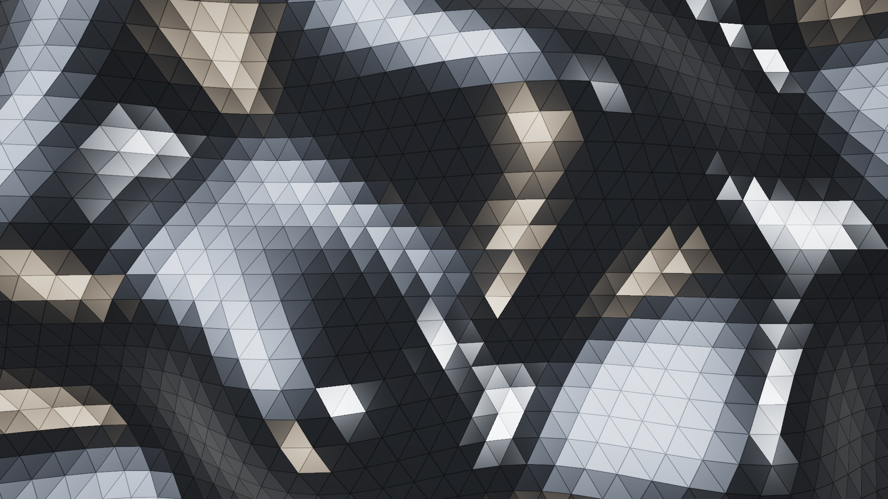
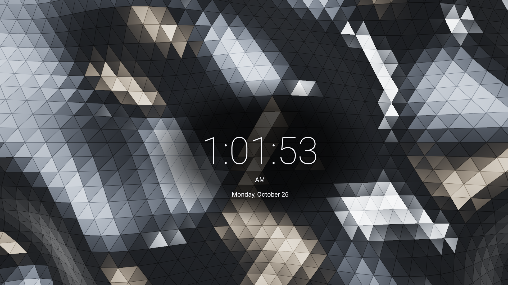
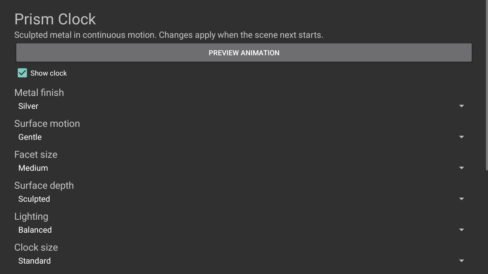
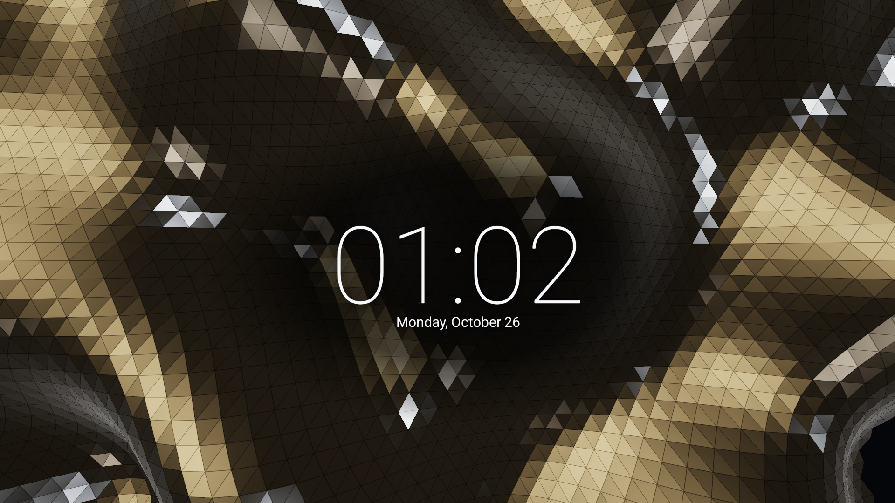
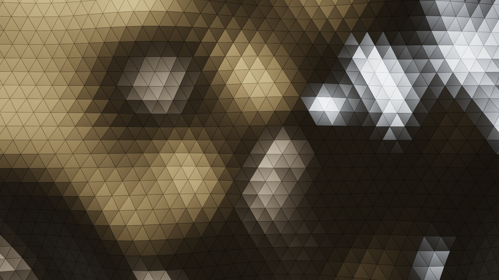
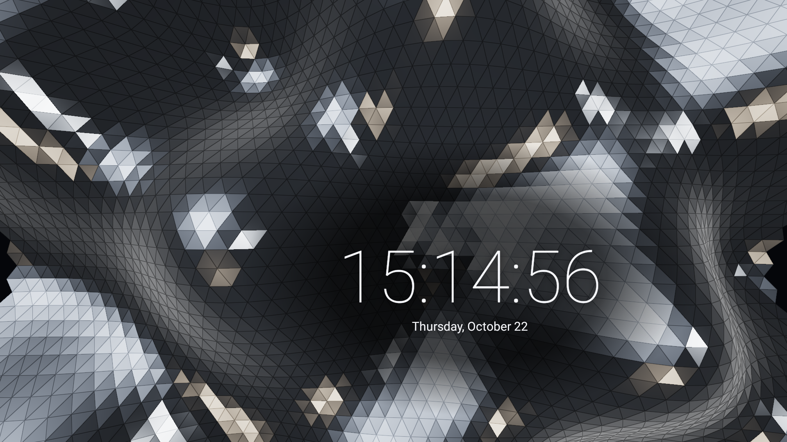
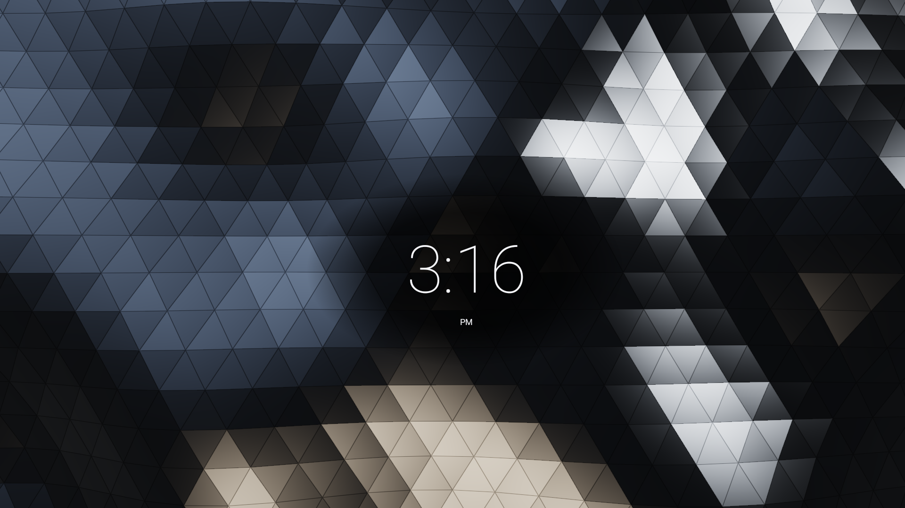
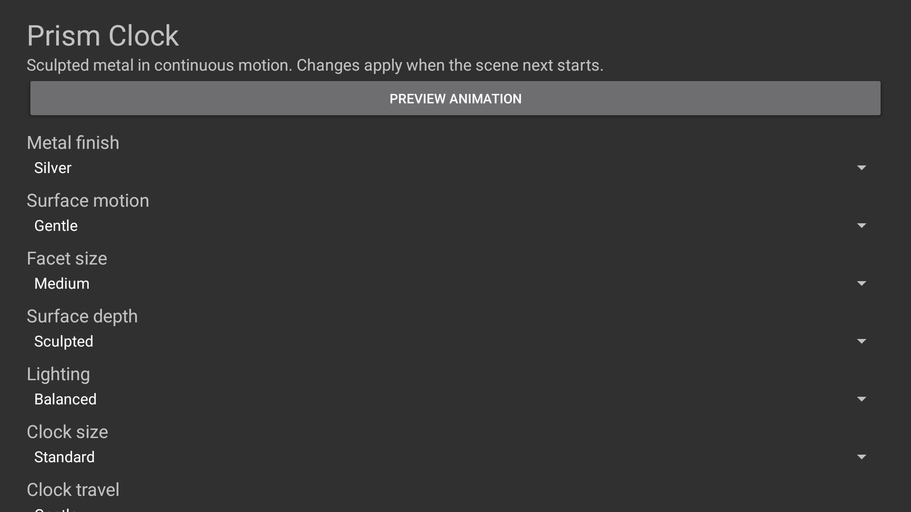
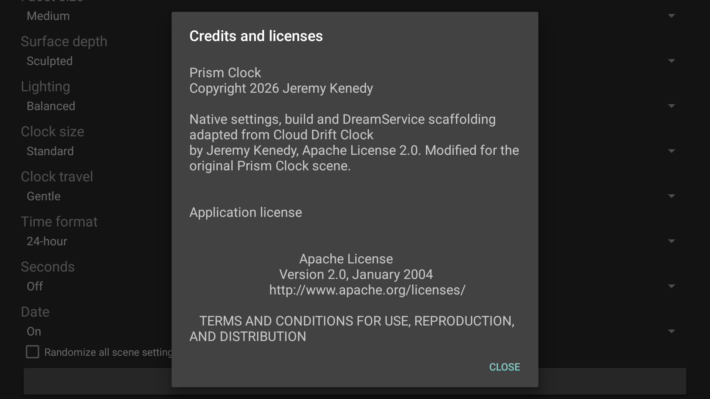
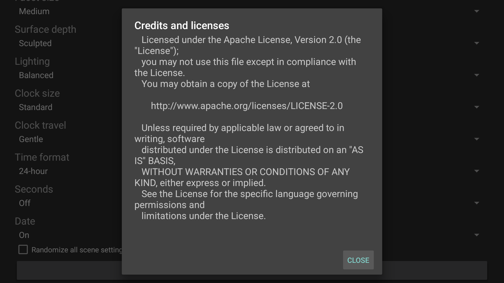

# Native screenshots

## Unreleased 1.1 optional clock

The current 1.1.0/code 2 API 34 captures show the actual same-signer candidate
`af3f00a2e9fb472c824d9279baa31420e7a9f8ab867cf135a662614f4838cf19`.
D-pad selection exercised the switch. Off removes time, date, period marker and
the clock backing while the surface continues moving. Physical and independent
moving review remain pending. [Current provenance](../art/screenshots/optional-clock-api34.json).

<table><tr><td></td><td></td><td></td></tr><tr><td></td><td></td><td></td></tr></table>

## Historical 1.0 release evidence

The final 1.0.0/code 1 APK is 127,947 bytes, SHA-256 `edbf475c4a2b253ccc069adaee8cac2cbba4d16b5579d5299e2e2d1bdaa21fd5`. Physical images use Fire TV AFTDEC012E/API 30. Credits/settings use Google TV API 34. Every capture is 1920x1080.

<table>
<tr><td></td><td></td><td></td></tr>
<tr><td></td><td></td><td></td></tr>
</table>

[Physical provenance](../art/screenshots/physical-fire-tv.json), [API 34 provenance](../art/screenshots/credits-api34.json) and [verification](verification.md) record exact artifact identities and limits. Scene geometry and reflections are rendered; this is an original animated design, not filmed material.
